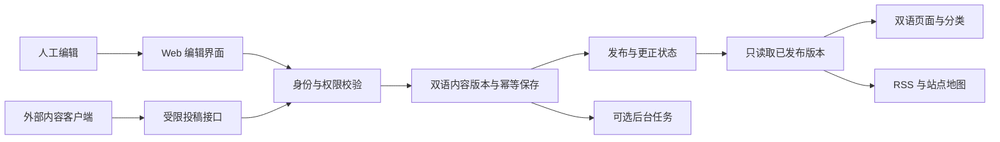

# 通用双语发布架构原理

本文是公开版的技术说明草案，不包含现有网站的运行参数、数据或机器人调教策略；安装验收完成前不表示已有独立可运行的发行版。

- **界面与数据库分工**：Web 层提供阅读与编辑体验；数据库事务维护稿件、版本、发布事件和访问权限。浏览器不持有服务端特权凭据。
- **双语版本**：两种语言保存在同一稿件的版本中，发布、更正与撤下明确绑定版本；语言切换定位同一条目。
- **投稿与鉴权**：人工与机器身份分开；每个机器身份独立停用或更换凭据。接口只接受该身份被允许的动作。
- **幂等与回执**：客户端提供请求标识，重复请求不会创建重复文章；状态查询受相同身份约束，不以客户端超时认定请求未完成。
- **公开读取**：列表、详情、订阅与地图只读取当前有效的公开版本。更正及撤回保留内部历史，不把草稿公开。
- **内容结构**：主分类与子分类有明确父子关系；输入在应用边界和数据库侧校验。文本与素材用途分别处理，不信任外部内容中的指令。
- **后台任务**：非必要任务与投稿解耦；单任务失败不阻塞其他任务，提供有限重试及明确错误记录。
- **隐私与运维**：部署实例各自管理身份、密钥、数据保存、备份及可选统计；公开仓库不携带任何运行站点的账号、日志或数据。

通用实现可以采用 TypeScript Web 框架、PostgreSQL、托管身份服务及独立任务执行器。具体依赖和数据库初始化方案以最终发行版的锁定文件及经过验证的安装说明为准。
